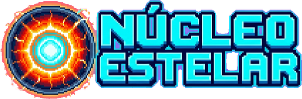
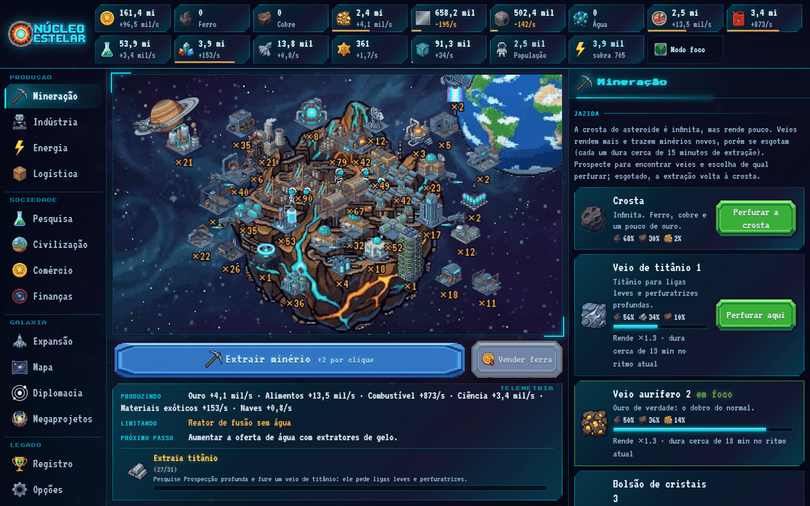
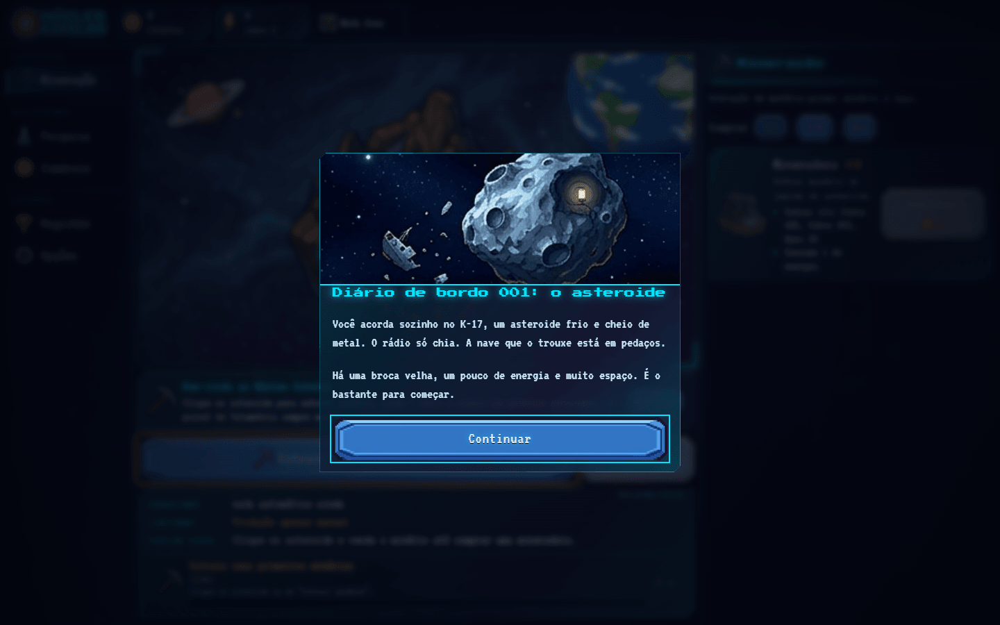
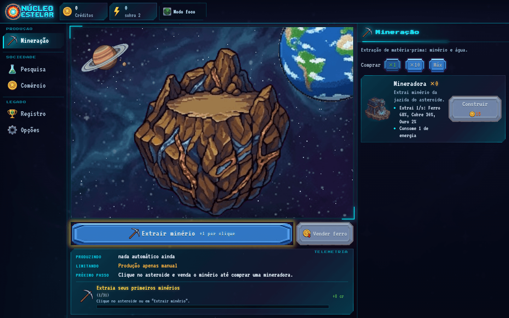
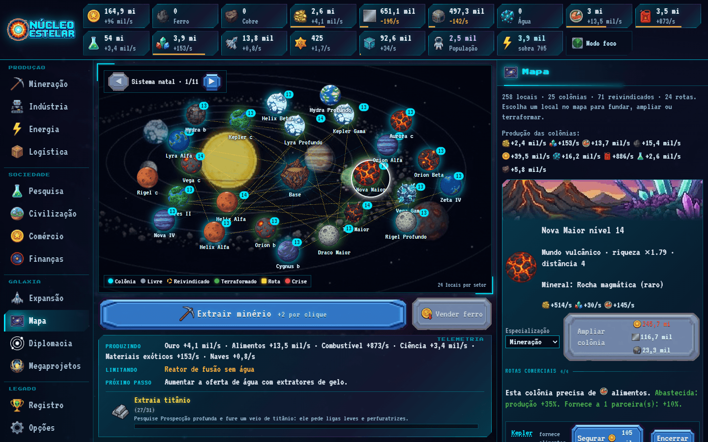
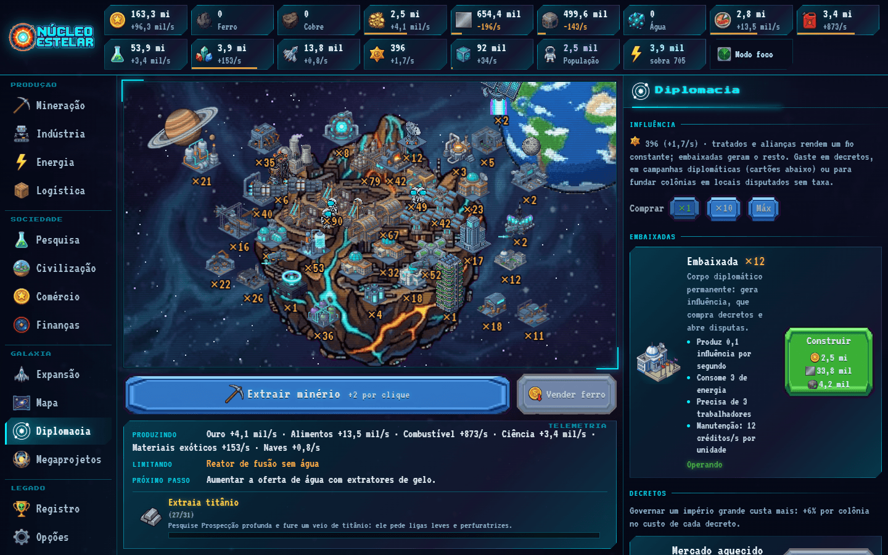
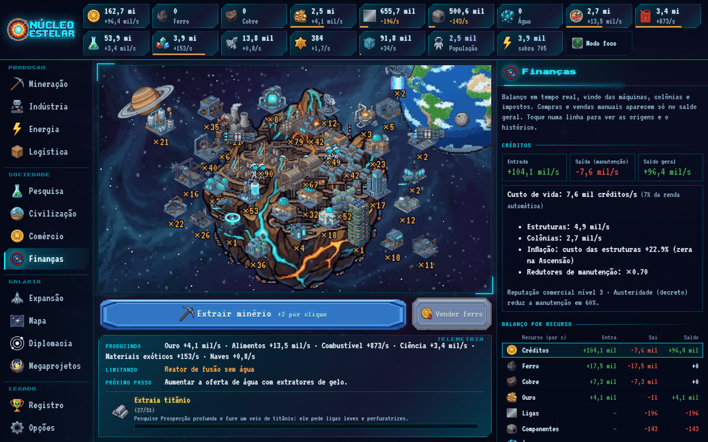
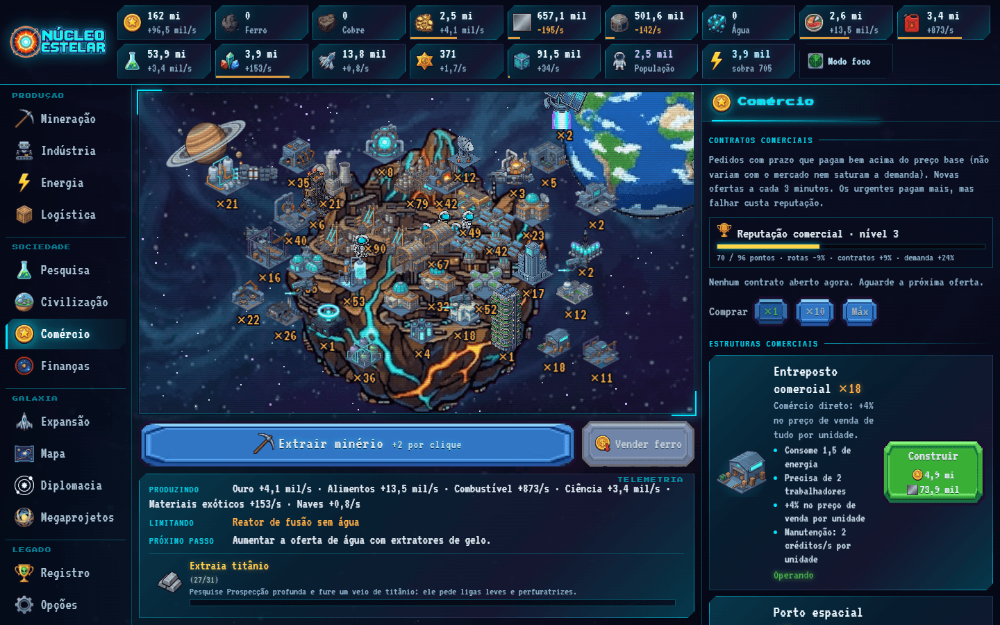
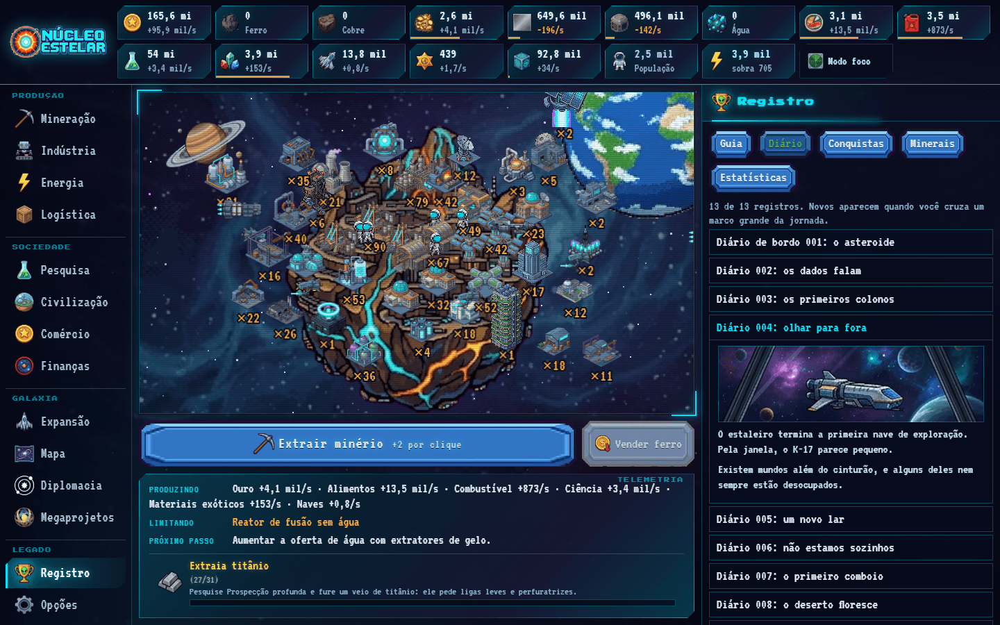
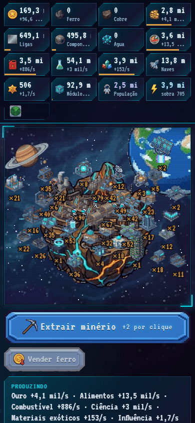

<div align="center">



### Um tycoon espacial idle em pixel art, direto no navegador.

Comece com uma broca num asteroide frio. Termine com uma estrela artificial no centro de um império.


[Como jogar](#-como-se-joga) · [O que tem no jogo](#-o-que-tem-no-jogo) · [Rodar](#-rodando) · [Por dentro](#-por-dentro) · [Documentação](#-documentação)

<br />



</div>

---

## ✨ O jogo

**Núcleo Estelar** é um jogo incremental (idle) de construção de império espacial. Você extrai minério, monta cadeias de produção, descobre mundos, negocia com facções rivais e, por fim, constrói uma estrela artificial que nunca para de crescer.

- **Infinito de verdade:** o *Núcleo Estelar* (megaprojeto) não tem último estágio, as pesquisas contínuas não têm nível máximo e cada novo local explorado é mais rico que o anterior.
- **Lento por design:** a primeira Ascensão leva cerca de um dia de jogo. A atenção é recompensada, mas nunca exigida.
- **Funciona offline:** a base continua produzindo por até 8 horas com a aba fechada.
- **Tudo no navegador:** sem servidor, sem conta. O progresso fica no seu `localStorage`, com backup automático e exportação em arquivo.

<div align="center">


</div>

---

## 🎮 Como se joga

1. **Extraia** minério clicando (ou segurando) no asteroide e venda o ferro.
2. **Automatize** com mineradoras, energia e refinarias. O painel de *Telemetria* sempre diz o que limita você e qual é o próximo passo.
3. **Cresça em camadas:** ciência e pesquisa → população e civilização → expedições e colônias → facções e comércio → megaprojetos.
4. **Ascenda** para recomeçar mais forte com melhorias permanentes. Mais tarde, **transcenda** e comece de novo num nível acima.

Os objetivos guiados, o guia no jogo e o diário de bordo acompanham cada fase. Quem quer só deixar rodando pode ligar o **modo foco**: a cena animada sai, um painel de alertas entra e o jogo gasta bem menos bateria.

---

## 🛰️ O que tem no jogo

<table>
<tr>
<td width="50%" valign="top">

### ⛏️ Mineração e jazida
A crosta do asteroide é infinita, mas rende pouco. Com **Geologia** você prospecta **veios**: reservas finitas que rendem mais e trazem **titânio** e **cristais**. Escolha de qual perfurar, deixe as **sondas autônomas** cuidarem disso ou esgote tudo de uma vez.

</td>
<td width="50%" valign="top">

### 🏭 Cadeias de produção
**35 estruturas** em 9 categorias, com três níveis de cadeia (minério → liga → componente → módulo), receitas alternativas e status claro do que trava cada máquina: energia, mão de obra, insumo ou armazém cheio.

</td>
</tr>
<tr>
<td valign="top">

### 🌌 Expansão
Expedições com naves e combustível, **mundos procedurais** de 10 tipos, colônias especializadas, **terraformação** em 5 níveis, rotas comerciais entre colônias (com bloqueios e seguro) e crises que nunca destroem progresso.

</td>
<td valign="top">

### 🤝 Facções
Três facções rivais com **pedidos**, tratados, alianças e **irmandade**. Quem é aliado de uma esfria a rival dela, e a desconfiança vira evento. A **influência** das embaixadas compra decretos e resolve disputas por territórios.

</td>
</tr>
<tr>
<td valign="top">

### 💰 Economia viva
Mercado com preços que oscilam **e uma demanda que satura** quando você vende demais. Manutenção, dívida, inflação, **reputação comercial**, contratos urgentes e uma aba **Finanças** com o balanço por recurso e o histórico.

</td>
<td valign="top">

### ♾️ Fim de jogo que recomeça
Enxame de Dyson, Núcleo Estelar infinito, **Singularidade** (o desfecho da história), **Ascensão** e **Transcendência**: duas camadas de recomeço com melhorias permanentes, conquistas que nunca se perdem e um catálogo de minerais.

</td>
</tr>
</table>

<div align="center">

| | |
|:---:|:---:|
| <br /><sub><b>Mapa estelar:</b> sistemas de 24 mundos, rotas e reivindicações</sub> | <br /><sub><b>Diplomacia:</b> pedidos, influência e decretos</sub> |
| <br /><sub><b>Finanças:</b> de onde vem e para onde vai cada recurso</sub> | <br /><sub><b>Comércio:</b> contratos, reputação e demanda do mercado</sub> |
| <br /><sub><b>Diário de bordo:</b> 13 registros de história</sub> | <br /><sub><b>No celular:</b> a interface se adapta à tela pequena</sub> |

</div>

<details>
<summary><b>Os números do jogo</b></summary>

<br />

| | |
|---|---|
| Estruturas | 35 |
| Pesquisas (árvore em 6 fases) | 53, mais pesquisas contínuas sem fim |
| Tipos de mundo | 10 |
| Facções | 3, cada uma com pedidos e quatro níveis de relação |
| Eventos espaciais | 12 |
| Conquistas | 46 (+2% de produção cada, permanentes) |
| Objetivos guiados | 31 |
| Registros do diário | 13 |
| Sprites | cerca de 380, recortados das pranchas de arte originais |

</details>

---

## 🚀 Rodando

Você precisa do [Node.js](https://nodejs.org) 20 ou mais novo.

```bash
git clone https://github.com/GustavoMarques06/Nucleo-Estelar.git
cd Nucleo-Estelar
npm install
npm run dev          # http://localhost:5173
```

| Comando | O que faz |
|---|---|
| `npm run dev` | servidor de desenvolvimento |
| `npm run build` | build de produção em `dist/` (já remove os sprites sem uso e recomprime os usados: ~5 MB) |
| `npm run preview` | serve o `dist/` localmente |
| `npm test` | todos os testes (economia, save, progressão, simulações) |
| `npm run check` | verificação de tipos + testes |
| `npm run audit` | exports sem uso, ciclos de importação, arquivos grandes |
| `npm run soak` | teste de resistência completo: campanha inteira até a Transcendência (leva vários minutos) |
| `npm run sprites` | regenera os sprites a partir das pranchas em `Assets/` |

---

## 🔧 Por dentro

### Stack

| Camada | Tecnologia |
|---|---|
| Build e dev server | Vite + TypeScript |
| Interface (painéis, menus) | React |
| Cena em pixel art | PixiJS 8, carregado sob demanda |
| Estado | Zustand |
| Testes | Vitest |
| Áudio | Web Audio: efeitos e música ambiente gerados no código, sem arquivos |
| Fontes | VT323 e Press Start 2P (Fontsource) |

### Como o código se organiza

O jogo é **orientado a dados**: criar uma estrutura, pesquisa, evento ou facção é acrescentar uma entrada em `src/game/data/`. A simulação, os painéis e o conselheiro (a Telemetria) funcionam a partir dela.

```
src/
├─ game/
│  ├─ data/        balanceamento e conteúdo (estruturas, pesquisas, facções, veios, eventos, diário...)
│  ├─ engine/      lógica pura: simulate(estado, dt) devolve um novo estado, sem efeitos colaterais
│  ├─ store.ts     estado global (Zustand) e ações do jogador
│  └─ loop.ts      simulação a 4 Hz, separada da renderização, e salvamento automático
├─ render/         cena PixiJS (asteroide, estruturas animadas, naves, drones)
├─ audio/          efeitos e música gerados com Web Audio
└─ ui/             componentes React e painéis
```

A simulação é uma função pura, e isso permite o que vem a seguir.

### Qualidade: o jogo joga sozinho nos testes

- **Jogador automático.** `engine/bot.ts` joga a campanha inteira com três perfis (ideal, casual e ocioso) e os testes falham se a progressão travar ou sair do ritmo.
- **Teste de resistência.** `engine/soak.test.ts` joga várias Ascensões conferindo a cada passo se o estado continua válido (números finitos, armazém dentro do limite, rotas sem duplicata, salvar → abrir sem perdas), volta de 8 h offline em cada fase e aplica centenas de ações aleatórias. Já encontrou e corrigiu bugs reais de salvamento.
- **Save à prova de falhas.** Dados do armazenamento nunca são confiados: `parseSave` valida e normaliza tudo. Há backup a cada ~10 minutos, recuperação de save corrompido e exportação/importação em arquivo.

### Ritmo do jogo

Tempo até a primeira Ascensão, medido com o jogador automático (uma pessoa leva mais):

| Perfil | Quanto joga | Primeira Ascensão |
|---|---|---|
| Ideal | atento o tempo todo | ~21 h |
| Casual | algumas visitas por hora | ~34 h |
| Ocioso | uma visita por hora | ~60 h |

As jornadas seguintes, com melhorias permanentes, são bem mais rápidas.

### Arte

Todos os sprites vêm de pranchas geradas por IA (em `Assets/`) e são recortados por scripts, sem edição manual:

- fundos quadriculados e magenta são removidos por segmentação;
- os recortes ficam descritos em `scripts/*.manifest.json`, com animações, níveis de estrutura e ilustrações do diário;
- o `npm run build` descarta os sprites que o código não usa.

---

## 📚 Documentação

- [Guia de desenvolvimento](docs/DESENVOLVIMENTO.md): sistemas, balanceamento, sprites e publicação em detalhe.
- [Documento de design (GDD)](nucleo_estelar_gdd.md): a visão original do jogo.
- [Pedidos de arte](pedidos-de-arte/): os prompts usados para gerar e refazer a arte.

## 🌐 Publicando

`npm run build` gera um site estático com caminhos relativos, que roda em qualquer hospedagem estática (GitHub Pages, Vercel, Netlify, Cloudflare Pages, itch.io). Não existe servidor para manter.

---

<div align="center">

Feito por [**Gustavo Marques**](https://github.com/GustavoMarques06) com a ajuda do [Claude Code](https://claude.com/claude-code).

</div>
